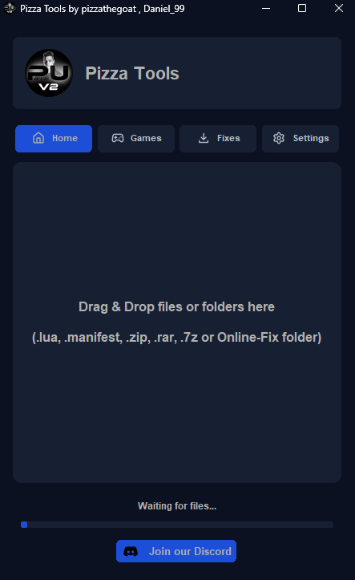
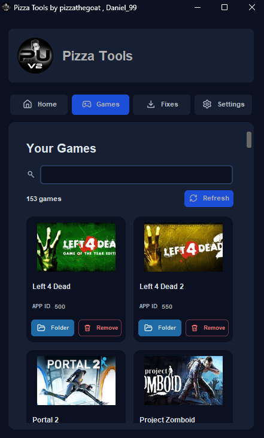
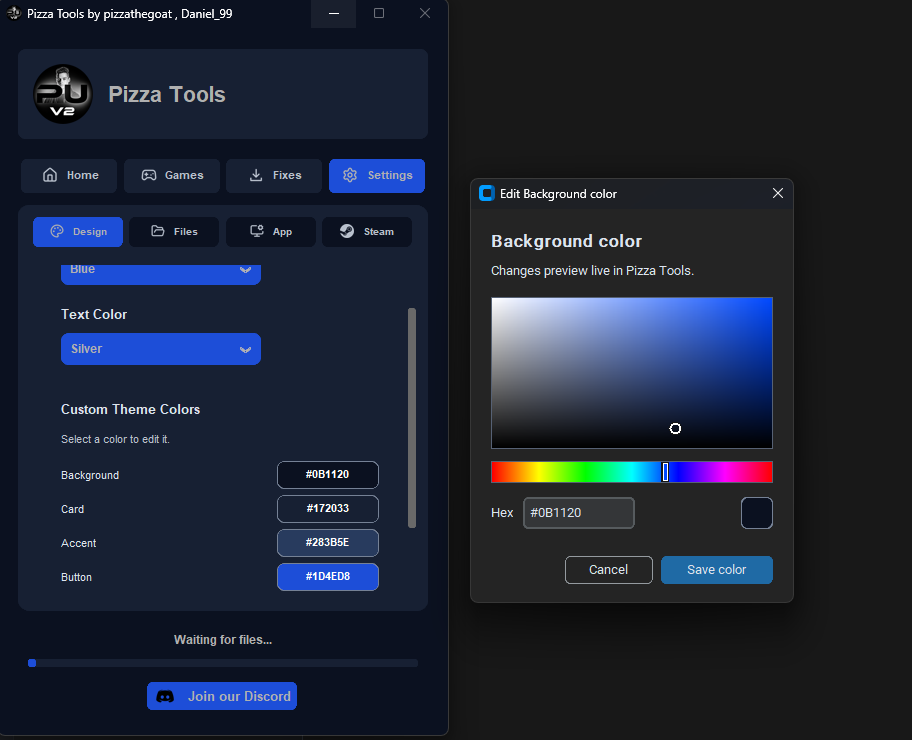
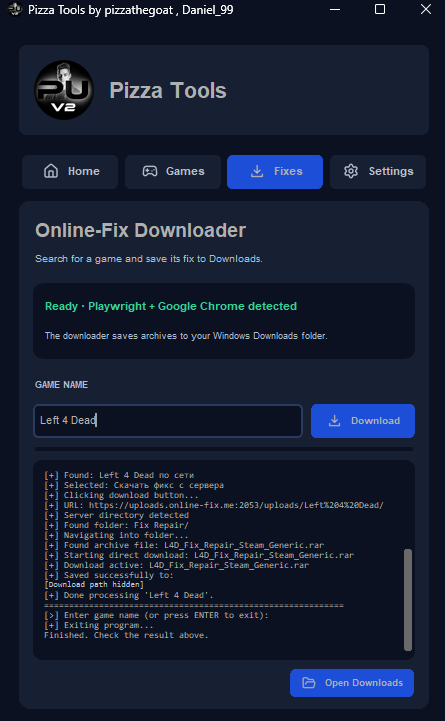

# Pizza Tools

[Download the latest release](https://github.com/pizzathegoat/PizzaTools/releases/latest) · [Report an issue](https://github.com/pizzathegoat/PizzaTools/issues)

## About

Pizza Tools is a free and open-source graphical interface for BetterSteamTools. It brings drag-and-drop manifest imports, Lua library management, theme customization, and quick removal together in one Windows desktop app.



## Getting started

1. Install **Python 3.10 or newer** for Windows and enable **Add Python to PATH** during setup.
2. Download **`Pizza_Tools.zip`** from the **Assets** section of the [latest release](https://github.com/pizzathegoat/PizzaTools/releases/latest). Extract the entire ZIP to a folder you can write to.
3. Run **`RUN THIS BAT !.bat`** once to install the Python dependencies. You can also run `python -m pip install -r requirements.txt` in the extracted folder.
4. Double-click **`main.pyw`** to start Pizza Tools.
5. Under **Settings → Files → Save Folder**, check that the path points to the Lua folder used by your BetterSteamTools setup. The default is `C:\Program Files (x86)\Steam\config\stplug-in`. Use **Browse** if Steam or your Lua folder is somewhere else.
6.Steam is required for Steam integration and manifest imports. After that close Steam and choose **Settings → Steam → Apply Patch**. The confirmation shows the destination. The patch copies files into the Steam installation.
## Import Lua files and manifests

Open **Home** and drop a file or archive onto the drop area. The status bar shows what Pizza Tools is doing and reports the result.

| Drop this | What Pizza Tools does |
| --- | --- |
| `.lua` | Copies the file to the configured **Save Folder**. |
| `.manifest` | Copies the manifest to the detected Steam installation's `depotcache` folder. |
| `.zip` with Lua files or manifests | Extracts supported entries and copies each file type to its corresponding folder. |
| Online-Fix folder or supported archive, such as `.rar` or `.7z` | Tries to match the fix to an installed Steam game and apply it to that game's folder. Archive extraction may require **7-Zip** or **WinRAR**. |

Under **Settings → Files**, you can optionally delete ZIPs after successful extraction or RARs after successful patching. Leave those options off if you want to keep the original archives.

## Browse and manage games

Open **Games** to see the Lua files in your configured Save Folder. Pizza Tools reads the Steam App ID from filenames such as `620.lua` and looks up the title and cover art when available. Search by **game name** or **App ID**, or use **Refresh** after changing the folder outside the app.

- **Folder** opens File Explorer and selects the game's Lua file.
- **Remove** asks for confirmation and deletes that Lua file. Installed game files are unaffected.
- **Settings → Files → Remove Game (by Game ID)** lets you do the same by entering the App ID.



## Customize the theme

In **Settings → Design**, choose a theme preset and text color. Under **Custom Theme Colors**, click a color swatch to open the picker. Drag in the color panel or enter a hex value such as `#2563EB`. The app previews changes as you make them.

Choose **Save color** to keep the change, **Cancel** to restore the previous color, or **Reset to Default** to clear all custom theme colors.



## Download and apply Online-Fix archives

The **Fixes** tab checks for **Playwright** and a supported browser. It can use **Google Chrome** or Playwright's **Chromium**. If the tab reports that the browser is missing, install Chrome or run:

```powershell
python -m playwright install chromium
```

Enter a game name and click **Download**. Follow the progress in the log and click **Open Downloads** to find the downloaded archive. To apply a supported fix to an installed game, drop the archive or extracted fix folder onto **Home**.



## Mini mode and app settings

Double-click the Pizza Tools logo to switch to the floating mini window. You can move it, drop supported files onto it, or double-click it again to return to the full app. Right-click it for the menu, including **Run in Background**, which sends Pizza Tools to the system tray.

Under **Settings → App**, you can enable Windows startup or turn on Discord Rich Presence. Under **Settings → Steam**, you can open or restart Steam and close it before applying the BetterSteamTools patch.


## Launch from the desktop or Windows Search

1. In Pizza Tools, go to **Settings → App → Desktop Shortcut** and click **Create Desktop Shortcut**.
2. Double-click **Pizza Tools** on your desktop to launch the app.
3. Once Windows indexes the shortcut, open **Start**, type **Pizza Tools**, and select the result to launch it from Windows Search. If it doesn't appear yet, use the desktop shortcut.

If you move the extracted Pizza Tools folder, create the shortcut again from the new location.

## Updates

Pizza Tools checks for updates on startup. You can also check manually under **Settings → App → Check for Updates**. When a newer release is available, **Update Now** downloads the ZIP, applies it to the current app folder, and restarts Pizza Tools.

Settings are stored separately at `%APPDATA%\PizzaTools\config.json`. If the updater cannot reach GitHub, you can download the ZIP manually from [Releases](https://github.com/pizzathegoat/PizzaTools/releases).

## Support

If something fails, [open a GitHub issue](https://github.com/pizzathegoat/PizzaTools/issues) with your Pizza Tools version, the steps you took, and the exact error message.

**Created by pizzathegoat and Daniel_99.**
